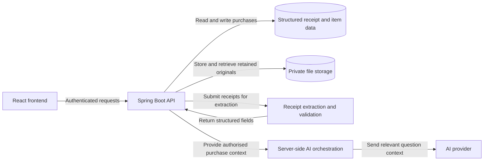

# Recora — Your everyday, understood.

Recora is a **Personal Purchase Intelligence Platform** in development. It is being built as an AI-powered receipt management and personal spending application that turns everyday receipts into searchable purchase records. The goal is to help people find proof of purchase, see what they bought, and make better-informed spending decisions.

**Product vision.** Turning everyday receipts into everyday intelligence.

**Project status.** This repository contains the React frontend for Receipts, Insights, and Ask AI. The UI can be explored locally. Authentication, receipt storage and extraction, and AI responses depend on the planned Spring Boot backend.

## Why Recora?

Paper receipts are easy to discard or lose. Digital receipts often end up scattered across email inboxes, retailer apps, and camera rolls. Traditional banking and expense tracking apps typically show the merchant, date, and transaction total. A banking app might show that you spent £85 at Tesco. A receipt can tell you which products accounted for that £85 and how much you paid for each one.

Recora is built around the receipt as both proof of purchase and a source of item-level data. Linking those uses makes it possible to look up an individual purchase and understand patterns across shopping trips.

| Problem                                               | How Recora aims to help                                                         |
| ----------------------------------------------------- | ------------------------------------------------------------------------------- |
| Receipts get lost or scattered                        | Collect paper receipt scans and digital receipts in one place.                  |
| Proof of purchase is hard to find                     | Find a purchase and retrieve its original receipt when retained.                |
| Manual expense tracking takes time                    | Extract receipt fields and line items for the user to review and correct.       |
| Spending habits are difficult to see                  | Summarise spending by month, category, and merchant.                            |
| Historical product prices are difficult to compare    | Compare amounts paid for equivalent products across saved receipts.             |
| Individual purchased products are difficult to search | Index line items so a product search leads back to the matching receipt.        |
| Purchase history requires manual analysis             | Answer questions from authorised receipt data and reference supporting records. |

## Questions Recora is designed to answer

These are product use cases. The current frontend can calculate spending summaries from supplied receipts. Item search, historical product matching, saved-file retrieval, and AI-generated answers require further integration.

- How much did I spend on groceries this month?
- Which supermarket did I spend the most money at?
- Where did I purchase my television?
- Can I retrieve my original receipt for a refund?
- How has my grocery spending changed over the last three months?
- Where did I previously purchase milk at the lowest price?
- Which products do I purchase most frequently?
- What are my highest spending categories?

**Historical price comparison** uses prices the user actually paid, recorded on saved receipts. Comparable results require equivalent products and consistent units or pack sizes. **Live supermarket price comparison** requires current, verified retailer offers and exact product matching. Insights can display retailer offers supplied to it, and no live price feed is connected.

## What the frontend implements

### Receipt management

- The upload dialog supports multiple PDF, JPEG, and PNG files. The browser validates file type and size against a limit of **10 files**, **4 MiB per file**, and **10 MiB per batch**. An optional upload handler receives the selected files and the original-file retention preference.
- Given receipt data, the page searches by merchant or category, filters by category or current month, sorts by date or amount, and displays receipt details and purchased items.
- The Edit receipt dialog validates corrections to merchant, purchase date, category, receipt total, and purchased items. It passes the corrected receipt to a supplied save handler while preserving receipt identity, currency, and original-file metadata. Delete, view original, and download original also use callbacks. The default application opens Receipts with an empty list. Saving changes, upload processing, and file retrieval require backend integration.

### Spending insights

- Calculates total spending, current-month spending, average receipt value, receipt count, monthly trends, and spending by category and merchant.
- Date filters cover all time, this month, or the last six calendar months including the current one. Date and category filters update the receipt summaries and breakdowns.
- Monetary amounts use integer pence and are displayed in GBP. The page distinguishes zero spending from empty results and supports loading and error states.
- Product nutrition and exact-match price comparison sections accept supplied data. The application currently opens Insights without receipts, product data, or retailer prices.

### Ask AI and account access

- Ask AI provides question suggestions and a multiline composer. With a request handler supplied, it supports follow-up questions, receipt reference labels, retries, and cancellation on reset or logout. Replies render as plain text. Chat stays in memory until the conversation is reset, the page is refreshed, or the user logs out.
- The default application supplies no AI handler, so users can draft questions but sending is disabled. The reference prototype's scripted answers are outside the React application.
- Sign-in and registration dialogs are placeholders with submission disabled. The Vite development server opens Receipts, Insights, and Ask AI directly. In a production build, signed-out visitors see the sign-in dialog. Home uses labelled examples to illustrate the product.

## How the application works

[App.tsx](src/App.tsx) manages navigation and frontend access state. Receipts and Insights accept typed data through React props. Receipts delegates data changes and file actions to callbacks, while Insights calculates aggregates in the browser. The shared receipt model includes merchant, purchase date, category, total, line items, and optional original-file metadata. Ask AI takes an asynchronous handler with a question, optional conversation ID, and cancellation signal.

| Area               | Technology or location                                                                   |
| ------------------ | ---------------------------------------------------------------------------------------- |
| UI                 | React, TypeScript, CSS, and Lucide React                                                 |
| Development        | Vite with the React plugin, npm, and a checked-in lockfile                               |
| Feature code       | [Pages](src/pages) and [components](src/components)                                      |
| Frontend contracts | [TypeScript models](src/types) for receipts, uploads, and conversations                  |
| Automated tests    | Vitest, React Testing Library, and jsdom, configured in [vite.config.ts](vite.config.ts) |
| Quality checks     | ESLint, Prettier, and [GitHub Actions](.github/workflows/ui-ci.yml)                      |

## Proposed end-to-end architecture

The React frontend is implemented here. The backend, storage, extraction, and AI services below are proposed.



1. **Capture and review.** A user selects files and chooses whether to retain them. The API would validate uploads, extract receipt fields and line items from PDFs or images, and return structured records for review and correction.
2. **Store and retrieve.** A structured data store would support receipt, item, and historical price queries. Original files would be kept in private storage when requested. The API would check ownership before granting access to either records or files.
3. **Analyse and answer.** The API would supply authorised receipts to Insights. For Ask AI, the backend would retrieve relevant purchase records, call the AI provider server-side, validate the answer, and attach supporting receipt references where available. Provider credentials would stay on the server.

### Development roadmap

1. Add a shared HTTP client and connect the frontend to Spring Boot for authentication, receipt ownership, and persistence.
2. Implement upload processing, extraction review, saving receipt corrections, and original-file retention and retrieval.
3. Add item search, product matching, and historical price comparisons using saved receipts.
4. Connect the Ask AI interface to server-side receipt retrieval, AI orchestration, and response validation.
5. Evaluate nutrition catalogues and live retailer pricing once verified data sources and exact product matching are available.

The planned HTTP client will centralise environment-based API configuration, authentication, headers, correlation IDs, cancellation and timeouts, error handling, optional distributed tracing, and logging that excludes receipt contents, conversations, and credentials.

## Run locally

Use **Node.js 22.22.2 or a newer 22.x release** to match the Node.js line in CI. From the repository root, run:

```sh
npm ci
npm run dev
```

Open the URL Vite prints and select **Receipts**, **Insights**, or **Ask AI** from the sidebar. Local development requires no API base URL, credentials, or `.env` file.

| Command                | Purpose                              |
| ---------------------- | ------------------------------------ |
| `npm test`             | Run the Vitest suite once.           |
| `npm run lint`         | Run ESLint.                          |
| `npm run format:check` | Verify Prettier formatting.          |
| `npm run format`       | Apply Prettier formatting.           |
| `npm run build`        | Type-check and build into `dist/`.   |
| `npm run preview`      | Serve the built application locally. |

Tests cover navigation and access, upload validation and receipt actions, spending calculations and filters, and chat submission, retry, and cancellation. The GitHub Actions workflow runs formatting checks, lint, tests, and the production build on pull requests and pushes to `main`.
